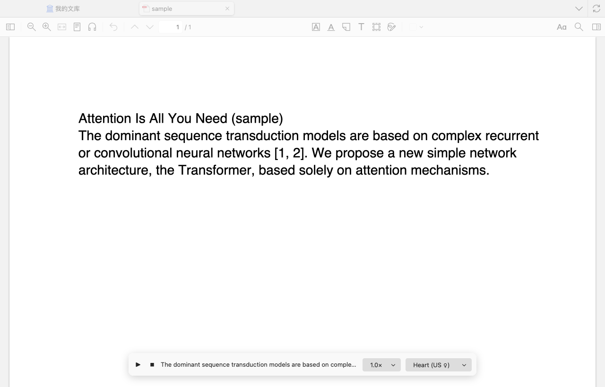

# Kokoro Reader for Zotero

[](https://www.zotero.org)
[](https://github.com/windingwind/zotero-plugin-template)
[](LICENSE)

Select text in a PDF and hear it read aloud by **[Kokoro-82M](https://huggingface.co/hexgrad/Kokoro-82M)**, a small open neural text-to-speech model. It runs entirely inside Zotero: no Python, no server, no account. After a one-time model download, it works offline and your text never leaves your computer.

[中文说明](#中文说明)



## Features

- **🔊 Read aloud**: reads the selected text. Use the button in the selection popup, the right-click menu, or the shortcut (default <kbd>⌥ Option</kbd>+<kbd>⇧ Shift</kbd>+<kbd>R</kbd> / <kbd>Alt</kbd>+<kbd>Shift</kbd>+<kbd>R</kbd>), which toggles reading.
- **⏩ Read from here**: keeps reading from the selected or right-clicked sentence to the end of the paper. Paragraphs come in reading order from Zotero's own document structure: two-column layouts and paragraphs split across pages are joined, running headers and page numbers are skipped, and reading stops at the References section.
- **Paper-friendly text cleanup**: joins words hyphenated across lines, skips citations like `[12]` and `(Smith et al., 2020)`, and reads `Fig. 3`, `Eq. (2)`, `e.g.`, `i.e.` naturally.
- **Player bar**: pause, resume, stop, current sentence, and speed and voice switches that apply right away.
- **17 English voices** (American and British). `af_heart` is the default.
- **Faster than real time on a laptop**: sentences are synthesized ahead of playback on a pool of workers (about 2× real time with 3 workers on Apple Silicon).
- **Starts quickly, no stutter**: the model loads in the background when you open a PDF. Audio starts about 2.5 s after you click, also when switching to another passage mid-read, and plays on without pauses.
- **Handles messy PDFs**: repairs ligatures that some PDFs extract as garbage ("\uFFFFrst" → "first", "di\uFFFFerent" → "different"), drops footnote markers, and reads exponents ("2^k" → "2 to the power k").

## Install

1. Download `kokoro-reader.xpi` from [Releases](../../releases).
2. In Zotero, open **Tools → Plugins**, click the gear icon, choose **Install Plugin From File…**, and select the file.

The first time you read something, the voice model (163 MB for the default fp16 precision) downloads from Hugging Face. Progress shows in the player bar.

## Settings

Find them under **Zotero Settings → Kokoro Reader**.

| Setting          | Default                  | Notes                                                                             |
| ---------------- | ------------------------ | --------------------------------------------------------------------------------- |
| Voice, Speed     | Heart, 1.0×              | Also switchable from the player bar while reading.                                |
| Skip citations   | on                       | Removes numeric and author-year citations.                                        |
| Shortcut         | `alt,shift,r`            | Modifiers and a key, comma-separated; `accel` means ⌘ on macOS, Ctrl elsewhere.   |
| Precision        | fp16                     | fp16 (163 MB) is fastest in Zotero. q8 (92 MB) is smaller but about half as fast. |
| Parallel workers | 0 (auto)                 | Each worker holds its own copy of the model (~300 MB of memory).                  |
| Download from    | `https://huggingface.co` | Point this at a Hugging Face mirror if needed.                                    |
| Model folder     | Zotero data directory    | Where the model is stored. **Delete downloaded model** frees the space.           |

### How it stays fast

- **Worker pool.** Chunks are synthesized in parallel on several workers, each with its own model copy (see below).
- **Shared queue.** A worker takes the next chunk only when it is idle, and one worker is kept free for the start of the next read.
- **Stopping mid-read.** ONNX Runtime can't be interrupted. When you stop, a worker that is still busy is replaced only if finishing its chunk would take longer than loading a fresh copy.
- **Chunk ramp.** Each read starts with a 16-character chunk (Kokoro needs ~2.2 s even for two words). Each later chunk is allowed to grow with the audio already queued before it, so it is ready by the time its turn comes.
- **No silent chunks.** With the fp16 weights on Zotero's WebAssembly backend, about 1 chunk in 20 of real paper text overflows, and the model returns an all-NaN waveform that plays as silence. "Theorem 1." and "Using ZK proofs," both did. The worker checks every waveform and retries at a 5% faster speed or with different final punctuation, which fixed every such chunk we found (16 of 300 on three papers). fp32 weights don't overflow, but need about 1 GB of memory per worker instead of 440 MB.
- **Trimmed padding.** Kokoro pads every clip with ~0.8 s of silence, which is trimmed to a pause that fits the punctuation.

Measured on an Apple M-series laptop with 4 workers: switching to another passage while reading gives first audio after 2.2–2.5 s, with no pauses over 0.2 s afterwards.

### Why a pool of workers?

Zotero is built on Firefox, and plugin workers can't use `SharedArrayBuffer`, so ONNX Runtime runs single-threaded there. On an Apple M-series CPU, one fp16 worker produces about 0.9 seconds of speech per second. Synthesizing different sentences on several workers at once fixes that:

| Precision | 1 worker | 2 workers | 3 workers |
| --------- | -------- | --------- | --------- |
| fp16      | 0.89×    | 1.63×     | 2.23×     |
| q8        | 0.51×    | 0.99×     | 1.31×     |

## Development

Built on [zotero-plugin-template](https://github.com/windingwind/zotero-plugin-template) and [zotero-plugin-scaffold](https://github.com/northword/zotero-plugin-scaffold).

```bash
npm install
cp .env.example .env   # set ZOTERO_PLUGIN_ZOTERO_BIN_PATH, and see the note below
npm start              # dev Zotero with hot reload, separate profile
npm test               # runs the mocha suite inside Zotero
npm run build          # .scaffold/build/kokoro-reader.xpi
```

> **Note:** when it exits, the scaffold kills every process whose command line contains "zotero", including your everyday Zotero. Set `ZOTERO_PLUGIN_KILL_COMMAND = pkill -9 -f "[r]epo-folder-name/.scaffold" || true` in `.env` so it only kills the dev instance.

The engine and UI tests download the model into `.scaffold/model-cache` on first run, which takes about a minute. CI skips them. `test/fixtures/sample-paper.pdf` is generated by `scripts/make-sample-pdf.py`.

"Read from here" uses reader internals (`_internalReader._loadSDT()`) that may change between Zotero versions. If they are missing, it falls back to reading the selection only.

| Path                       | What it does                                                            |
| -------------------------- | ----------------------------------------------------------------------- |
| `src/modules/text.ts`      | Cleans selected PDF text and splits it into sentences (pure functions). |
| `src/modules/engine.ts`    | Downloads and caches the model, manages the worker pool.                |
| `src/worker/tts.worker.ts` | Runs Kokoro (kokoro-js + transformers.js + ONNX Runtime wasm).          |
| `src/modules/player.ts`    | Prefetches sentences and plays them with Web Audio.                     |
| `src/modules/reader.ts`    | Selection popup button, context menu, shortcut.                         |
| `src/modules/bar.ts`       | Floating player bar.                                                    |

### Release

Push a `v*` tag. The GitHub workflow builds the xpi and publishes `update.json`, so installed copies update themselves like other plugins. Before the first release, replace `OWNER` in `package.json` with your GitHub user or organization.

## Credits

- [Kokoro-82M](https://huggingface.co/hexgrad/Kokoro-82M) by hexgrad, Apache-2.0, via the [ONNX export](https://huggingface.co/onnx-community/Kokoro-82M-v1.0-ONNX)
- [kokoro-js](https://github.com/hexgrad/kokoro/tree/main/kokoro.js), [transformers.js](https://github.com/huggingface/transformers.js), [ONNX Runtime Web](https://onnxruntime.ai), and [phonemizer](https://github.com/xenova/phonemizer) (eSpeak NG)

## License

AGPL-3.0-or-later

---

## 中文说明

在 Zotero 里选中 PDF 文字，用开源神经网络语音 **Kokoro-82M** 朗读出来。

- **安装**：在 Releases 下载 `kokoro-reader.xpi`，然后在 Zotero 打开「工具 → 插件」，点齿轮图标，选「从文件安装插件…」。
- **朗读选中内容**：选中文字后，点弹出框里的「🔊 朗读 (Kokoro)」，或者按 <kbd>⌥</kbd>+<kbd>⇧</kbd>+<kbd>R</kbd>（Windows/Linux 按 <kbd>Alt</kbd>+<kbd>Shift</kbd>+<kbd>R</kbd>），再按一次停止。
- **从这里读下去**：点弹出框里的「⏩ 从这里读下去」，或者在 PDF 上右键选「从这里开始朗读 (Kokoro)」，会从那句开始一直读到文末。双栏排版、跨页段落都能按阅读顺序读，自动跳过页眉和页码，读到参考文献就停。
- **播放条**：底部的播放条可以暂停、继续、停止，也能切换语速和音色。
- **启动快**：打开 PDF 时会在后台加载模型；第一句会切短，大约 2–3 秒就开始出声。
- **首次使用**会自动下载约 163 MB 的模型（下载地址可在设置里改成镜像）。之后完全离线，文字不会离开你的电脑。
- 朗读时会自动合并跨行断词、跳过 `[12]`、`(Smith et al., 2020)` 这类引用，并把 `Fig.`、`Eq.`、`e.g.` 读成完整的词。
- 目前只支持**英文**。
